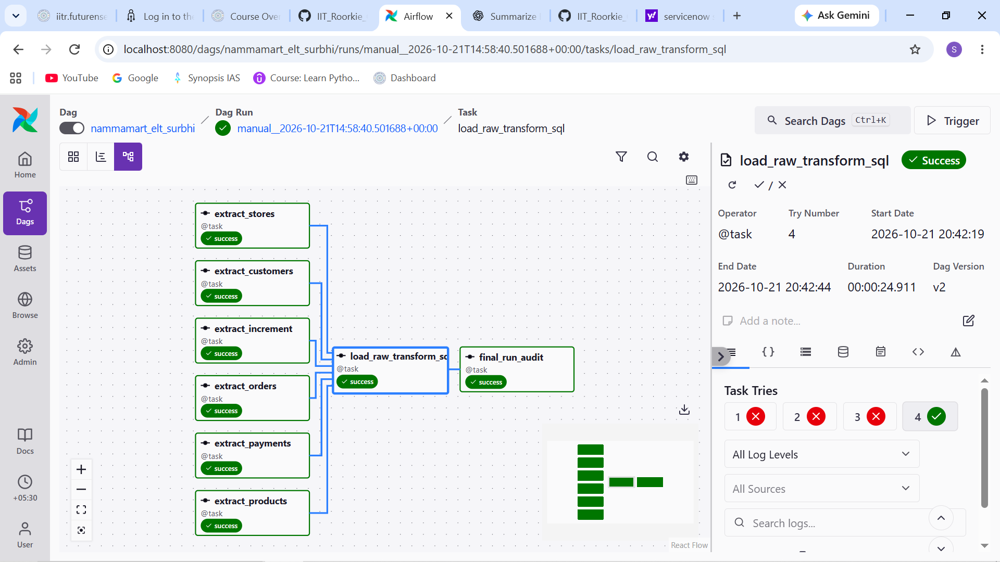
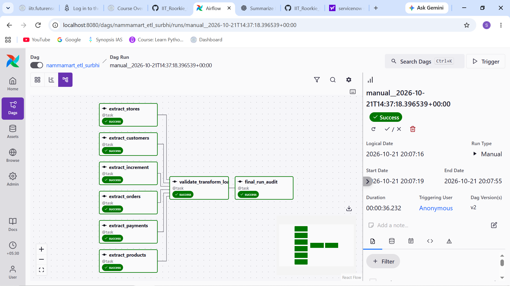
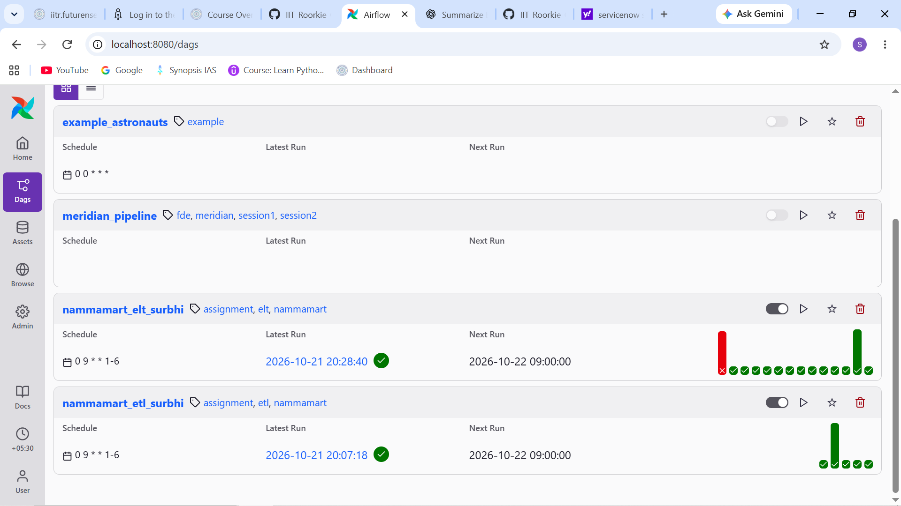
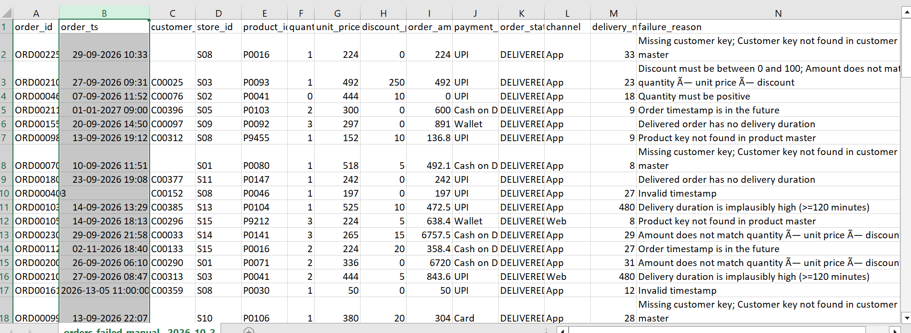
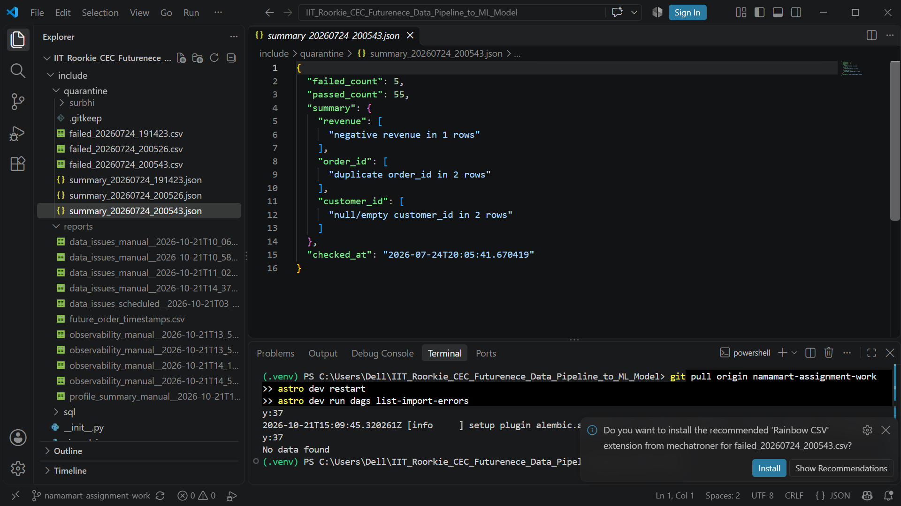
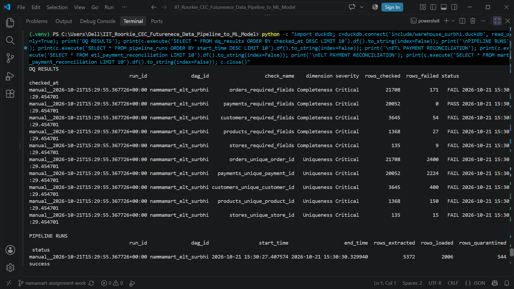
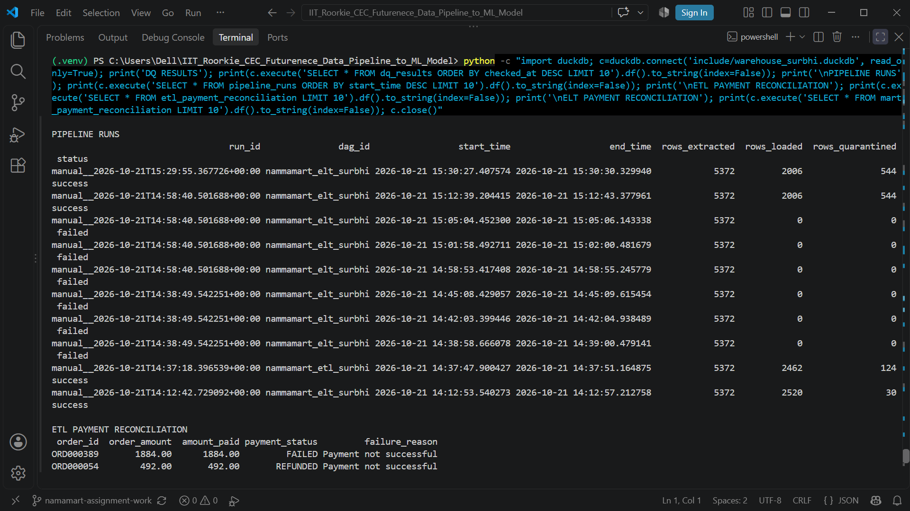
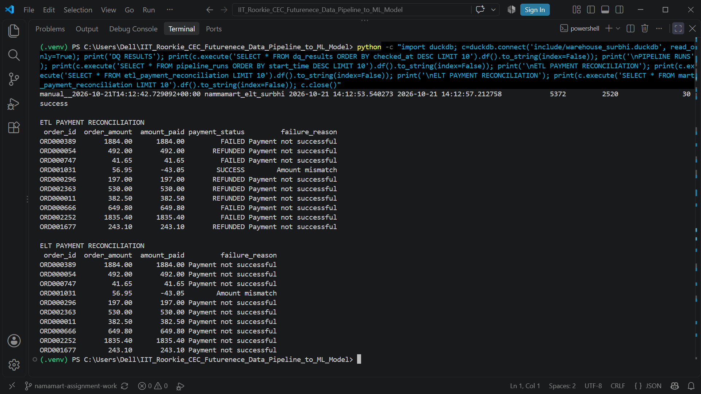

# NammaMart ETL & ELT Data Pipeline — Submission

**Author:** Surbhi Soni  
**Working branch:** `namamart-assignment-work`  
**Warehouse:** `include/warehouse_surbhi.duckdb`  
**DAGs:** `nammamart_etl_surbhi`, `nammamart_elt_surbhi`


## Reviewer quick navigation

- **Original assignment / acceptance criteria:** [ASSIGNMENT.md](https://github.com/UmashankarKH/IIT_Roorkie_CEC_Futurenece_Data_Pipeline_to_ML_Model/blob/main/assignment/ASSIGNMENT.md)
- **DAG code:** [dags/](dags/)
- **SQL transformations and six business questions:** [include/sql/](include/sql/) · [business_questions.sql](include/sql/business_questions.sql)
- **Data issues log and run reports:** [include/reports/](include/reports/)
- **Quarantine evidence:** [quarantine screenshot](screenshots/04_quarantine_failure_reasons.png); runtime quarantine CSVs are generated locally under `include/quarantine/surbhi/` and are not currently committed as static evidence files.
- **All screenshots:** [screenshots/](screenshots/)

The screenshot index at the end of this document is the single visual-evidence entry point. Screenshot links open the original PNG files in this branch. The images are evidence of the named views only; they do not substitute for the controlled-run results still identified as outstanding in the experiment table.

## 1. Solution overview

This submission implements two comparable pipelines over the same six source exports.

- **ETL:** parallel source-file/schema checks, Python validation, quarantine reports, PII masking, a DuckDB fact/dimension model, revenue/margin summaries, and payment reconciliation.
- **ELT:** raw source tables with ingestion metadata, SQL transformations stored in `include/sql/elt_staging_dimensions.sql`, `include/sql/elt_staging_orders.sql`, and `include/sql/elt_marts.sql`, newest-version-wins order staging for the incremental feed, and source-volume/freshness/distribution reports.
- **Schedule:** `0 9 * * 1-6`, explicitly in `Asia/Kolkata`; 09:00 IST equals 03:30 UTC. `catchup=False` avoids replaying historical intervals. A laptop-based scheduler cannot run while Docker/the host is off, so a production deployment needs an always-on runtime and missed-run alerts.
- **Auditability:** `dq_results` stores per-rule results across the six dimensions; `pipeline_runs` stores run summaries. Both DAGs include an `all_done` final audit task to cover failures that happen before the main pipeline helper starts.

Source CSVs are inputs and must not be manually edited. Experiments must use temporary copies and restore the originals immediately afterward. The six source files are committed under [`include/data/nammamart/`](https://github.com/surbhisoni1008-maker/IIT_Roorkie_CEC_Futurenece_Data_Pipeline_to_ML_Model/tree/namamart-assignment-work/include/data/nammamart) so a reviewer can reproduce the pipeline without relying on a local-only dataset. The live DuckDB warehouse and generated run reports remain local artifacts; the screenshots below preserve the available run evidence.

## Part C. Scheduling and orchestration answers

- **Schedule:** `0 9 * * 1-6` in `Asia/Kolkata` means 09:00 IST, Monday through Saturday. It does not schedule a Sunday run.
- **Catch-up:** `catchup=False` prevents Airflow from automatically creating runs for all missed historical intervals when the DAG is first enabled.
- **UTC conversion:** 09:00 Asia/Kolkata is 03:30 UTC. If the cron were interpreted in UTC instead of Asia/Kolkata, a 09:00 cron would run at 14:30 IST, five hours and thirty minutes late.
- **Host downtime:** with local Astro/Docker stopped, the scheduler cannot run the job at 09:00. It will not provide an on-time report while the host is off; use an always-on runtime and alert on missed/failed runs in production.
- **Retries:** each DAG allows two retries with a three-minute delay. This helps with transient failures; it will not repair bad source data or a persistent schema error.
- **Dependencies:** the six source/schema-check tasks feed the main transform/load task. A final audit task uses `all_done` so it can attempt to record an audit outcome after the main task finishes.
- **Operational limitation:** the local Astro/Docker scheduler can run only while the host and Docker environment are available. Production scheduling needs an always-on orchestrator, alerting, and a documented recovery process.

## Part 0. Initial profiling and issue log

The profiler writes a per-run column-level summary and flags nulls and duplicate business keys across the five base files and the incremental order feed. The following issues have been observed in the available run evidence; they are data-quality findings, not proof that the source file was changed.

| Issue | Evidence / impact | Handling |
|---|---|---|
| Five future-dated order timestamps | The ELT observability report identified five future timestamps; sample rows are listed in `include/reports/future_order_timestamps.csv`. Future dates can distort freshness and time-based metrics. | Keep source unchanged, flag the records, and review with the data owner before correcting source values. |
| Incremental feed contains order versions | Base orders and `orders_2026-10-01_increment.csv` are both ingested. The latest version should win for the current-state staging/fact model, while raw ELT inputs remain available for audit. | Compare order IDs and changed fields; verify idempotency and correction behavior with a controlled experiment. |
| Source-level nulls, duplicates, invalid values, and schema drift | The profiler and per-rule scorecards are designed to record these; actual counts vary by run and must be read from that run's report and `dq_results`. | Quarantine rejected rows where supported; fail clearly on missing required columns; do not claim a test passed without run evidence. |
| Reconciliation exceptions | Payment/order amount mismatches, missing payments, and unsuccessful payment statuses are represented in reconciliation tables. | Review exceptions with Finance; do not silently force payment totals to match. |

**Open questions for the business:** confirm the policy for negative quantities/returns, whether late return status changes restate the original order date or book a reversal on the return date, and the matching tolerance/allocation policy for partial or split payments.


### Source profiling results (source files left unchanged)

The following counts are from a direct profile of the six supplied CSV exports. “Duplicate-key rows” counts every row whose business key appears more than once, not the number of duplicate groups. Date-based future checks are time-dependent; the run report records five future order timestamps for the observed run.

| Source file | Rows × columns | Nulls / notable values | Duplicate-key rows | Quality findings and dimension |
|---|---:|---|---:|---|
| `orders.csv` | 2,412 × 13 | `order_ts`: 1; `customer_id`: 18; `delivery_minutes`: 164 | `order_id`: 24 | Completeness: missing order/customer/delivery fields. Uniqueness: repeated order IDs. Validity: 3 invalid statuses, 3 invalid payment modes, 3 discounts outside 0–100. Accuracy: 10 non-positive quantities, 18 amount-formula mismatches. Consistency: 9 unknown product keys and 5 unknown store keys; customer-key exceptions also appear. Timeliness: future timestamps. |
| `payments.csv` | 2,228 × 7 | `gateway_ref`: 301 | `payment_id`: 8 | Completeness: missing gateway references. Uniqueness: repeated payment IDs. Validity/accuracy: source includes non-standard payment modes/statuses and negative amounts. Consistency: 8 payment rows refer to order IDs absent from the base orders file. |
| `customers.csv` | 405 × 10 | `city`: 6 | `customer_id`: 10 | Completeness: missing city. Uniqueness: repeated customer IDs. Validity/timeliness: inconsistent loyalty-tier casing and 3 future signup dates. PII fields include name, email, phone and location attributes. |
| `products.csv` | 152 × 10 | `category`: 3 | `product_id`: 4 | Completeness: missing category. Uniqueness: repeated product IDs. Accuracy: 1 non-positive MRP and 5 rows where cost price exceeds MRP. |
| `stores.csv` | 15 × 8 | `zone`: 1 | `store_id`: 0 | Completeness: missing zone. Accuracy/validity: 1 non-positive daily capacity. |
| `orders_2026-10-01_increment.csv` | 160 × 13 | No blank fields detected in the basic null scan | `order_id`: 0 | Incremental feed includes later versions of existing orders as well as new orders. Validate status corrections and latest-version-wins behaviour separately from base-file duplicate checks. |

A row-keyed, issue-level log with file, row key, column, problem, quality dimension, proposed rule, and severity is committed at [`include/reports/data_issues_initial_profile.csv`](include/reports/data_issues_initial_profile.csv). It was generated from the supplied source snapshot; it contains issue descriptions and keys, not raw customer contact details.

These are profiling findings, not instructions to alter source data. The pipeline should preserve the raw exports and record each row-level rejection with a reason. Some row counts overlap because one row can violate more than one rule.

## 2. Profiling and issue handling

The shared profiler inspects all six source files for nulls and duplicate business keys. ETL checks order status, timestamp, discount range, quantity, calculated amount, master-key integrity, delivered-order duration, and future timestamps. Schema assertions fail loudly when required columns are absent. The ELT scorecard also checks completeness, uniqueness, validity, accuracy, consistency, and timeliness with separate rows per rule.

The per-run column-level profile (row counts, nulls, distinct counts, numeric/date ranges, and selected categorical distributions) is written to `include/reports/profile_summary_<run_id>.csv`; issue and observability artifacts are also written under `include/reports/`. Rejected ETL orders are written under `include/quarantine/surbhi/`. Reports should be reviewed by source file, row key, column, quality dimension, and severity before a business rule is changed.

### Questions for the client

1. Should a negative quantity mean a return, or should it always be treated as a data-entry error?
2. When an order changes to RETURNED in a later feed, should Finance restate the original order date or book the reversal on the return date?
3. What matching tolerance and allocation rules should apply to partial or split payments?

## 3. Data quality scorecard

The scorecard writes the required fields: `run_id`, `dag_id`, `check_name`, `dimension`, `severity`, `rows_checked`, `rows_failed`, `status`, and `checked_at`.

| Dimension | ETL checks | ELT checks |
|---|---|---|
| Completeness | Required fields in orders, payments, customers, products, stores | SQL required-field checks against raw tables |
| Uniqueness | Order, payment, customer, product, and store business keys | SQL duplicate-key checks against raw tables |
| Validity | Allowed order/payment values and email format | SQL allowed-value checks |
| Accuracy | Order amount formula and positive product prices | SQL amount formula and product-price checks |
| Consistency | Order-to-customer/product/store keys and payment-to-order keys | SQL referential-integrity checks |
| Timeliness | Future and stale order timestamps | SQL future and stale timestamp checks |

Critical failures are recorded as `FAIL`; warning-level failures are recorded as `WARN`. A scorecard row is emitted for each rule on each run.

## 4. Governance and data dictionary

### Ownership and rule approval
Operations owns orders and store master data; Finance owns payment records and reconciliation policy; CRM owns customer data; Merchandising owns product data; Data Engineering owns warehouse models and pipeline controls. Changes to financial rules require the relevant business owner and Finance approval, with a versioned change record.

### Core warehouse dictionary

| Table | Important columns | Meaning / source | PII |
|---|---|---|---|
| `etl_fact_orders` | `order_id`, `order_ts`, `customer_id`, `product_id`, `store_id`, `quantity`, `order_amount`, `net_revenue`, `gross_margin`, `within_15_min` | Validated order rows joined to CRM, product, and store dimensions | Customer key may be linkable; email/phone are masked |
| `etl_dim_customer` | `customer_id`, `email`, `phone`, `city`, `area`, `pincode`, `loyalty_tier` | CRM customer attributes | Yes; email/phone masked in reporting table |
| `etl_dim_product` | `product_id`, `category`, `mrp`, `cost_price` | Product catalogue and pricing | No |
| `etl_dim_store` | `store_id`, `zone`, `area`, `capacity_orders_per_day` | Store master | Manager name may identify a person |
| `raw_orders` / `raw_payments` | Source columns plus `_loaded_at`, `_source_file`, `_run_id` | Original ELT inputs for replay and audit | Depends on source fields |
| `stg_orders` | Typed columns, `dq_status`, `failure_reason` | Current order version after SQL standardisation and checks | Customer key may be linkable |
| `mart_daily_store_kpis` | `order_date`, `zone`, `store_id`, `net_revenue` | Daily delivered-order revenue by store | No direct contact details |
| `mart_category_margin` | `category`, `revenue`, `gross_margin` | Revenue and margin by category | No |
| `mart_delivery_sla` | `avg_delivery_minutes`, `pct_within_15_min` | Store delivery performance | No |
| `mart_payment_reconciliation` | `order_id`, `order_amount`, `amount_paid`, `failure_reason` | Payment/order exceptions | Order identifier only |
| `mart_top_customers` | `customer_id`, `loyalty_tier`, `spend` | Top customers by delivered spend; no contact details | Customer key is linkable |

### Governance decisions against the nine client questions

1. **Ownership and rule approval.** Operations owns orders and store master data; Finance owns payments, revenue definitions and reconciliation tolerance; CRM owns customer records; Merchandising owns product catalogue/prices; Data Engineering owns warehouse models, orchestration and scorecards. The relevant owner and Finance must approve a financial-rule change, with a dated/versioned decision recorded before deployment.

2. **Data dictionary and semantics.** Source types are inferred at ingestion and cast in staging: IDs are strings, timestamps/dates are timestamp/date types, counts/quantities are integers, and prices/amounts/percentages are numeric decimals/doubles. Order statuses are DELIVERED/CANCELLED/RETURNED; payment modes are UPI/Card/Cash on Delivery/Wallet; customer email, phone, name, city, area and pincode are personal or potentially identifying data. The warehouse dictionary above identifies each reporting table's source and PII exposure; raw tables retain the original source representation.

3. **Lineage.** To trace a KPI, filter `etl_fact_orders` or `mart_daily_store_kpis` to one `order_date`/store and join its `order_id` values back to `orders.csv`; join `store_id` to `stores.csv` to validate the zone. ELT is easier to audit because raw rows retain `_source_file` and `_run_id`; for production, carry a source-row/order-ID bridge through aggregates so an auditor can reproduce the exact contributing IDs.

4. **Personal data and law.** Treat `full_name`, `email`, `phone`, `city`, `area`, `pincode`, and linkable customer IDs as personal or potentially identifying data. Mask email/phone in reporting tables rather than deleting all linkage, because authorised support/audit may need a controlled join; expose only the minimum fields needed. The Digital Personal Data Protection Act, 2023 and applicable rules should be assessed with counsel for notice, lawful processing, security safeguards, retention/deletion and data-principal rights.

5. **Access control.** Raw tables and raw customer files should be limited to authorised data operators and auditors under least privilege; staging should be limited to data engineering/quality operators; marts should be the default business-consumer surface; quarantine should be restricted to staff resolving data issues. Do not grant broad analyst access to unmasked raw customer contact/location data.

6. **Retention.** Adopt a written, purpose-based schedule approved by Legal and Finance rather than inventing a universal duration: retain raw data only as long as required for audit/business/legal obligations, quarantine until remediation plus the approved audit window, and masked/aggregated reporting data according to reporting needs. At expiry, delete securely or irreversibly anonymise; document legal holds and deletion runs.

7. **Secrets.** This local assignment does not require a live API secret. If alerts are enabled, store credentials in Airflow Connections/Variables or a supported secret backend, and read them at runtime. Never place tokens, passwords, or webhook URLs in DAG source, screenshots, logs, or Git history.

8. **Rejected-order audit.** Select an order ID from the quarantine CSV, read the original row from `orders.csv`, and match its `failure_reason` to the quality rule and `dq_results` row for that run. Then query the ETL fact table and ELT validated mart/staging status for the same ID to show it is excluded from delivered revenue; keep the original raw ELT row for audit.

9. **Late return / change history.** The current-state model uses the latest increment version, so an order changed to RETURNED is excluded from current delivered-order revenue even if its original timestamp is in September. Finance may need both a current restated view and an as-known-at-the-time view; retain append-only raw versions and add effective/recorded timestamps or a history table to reproduce both.

### Lineage, privacy, access, retention, and secrets
A store's daily revenue starts with an order row in `orders.csv`, passes ETL order validation or ELT staging rules, joins to `stores.csv` for the zone/store attributes, and is grouped by order date and store in the corresponding daily mart. ELT raw tables retain source-file and run metadata; rejected orders can be traced to their staging failure reason. ETL's issue/quarantine files identify rejected order keys and reasons.

Customer name, email, phone, and address-like attributes (city, area, pincode) can be personal data. Keep unmasked source PII restricted to authorised operators; provide masked contact fields or aggregated marts to business users. Apply the Indian Digital Personal Data Protection Act, 2023 and applicable rules as confirmed by counsel. Retention should be purpose-based, approved by Legal/Finance, and followed by deletion or irreversible anonymisation unless a legal hold applies. Store credentials only in Airflow Connections/Variables or a secret backend; never commit them to GitHub.

## 5. Observability and run evidence

The pipeline emits source-volume metrics, a freshness age based on the newest non-future order timestamp, a separate future-timestamp count, and per-store average order-amount drift metrics. Schema checks fail on missing required columns. The ELT raw layer records source file and run identifiers. Query the following after each run:

```sql
SELECT * FROM dq_results
ORDER BY checked_at DESC, dag_id, dimension, check_name;

SELECT * FROM pipeline_runs
ORDER BY end_time DESC;

SELECT * FROM etl_payment_reconciliation
ORDER BY order_id;

SELECT * FROM mart_payment_reconciliation
ORDER BY order_id;
```

### Observed local ELT run
- DAG run completed green in the local Airflow environment.
- `raw_orders`: 21,708 rows; `raw_orders_increment`: 1,440 rows; `stg_orders`: 2,550 rows.
- On the repeated run, raw table counts remained stable and staging contained 2,550 rows with 2,550 distinct order IDs.
- A happy-path observability report recorded freshness at approximately 0.17 hours and flagged five future-dated source order timestamps. The original source CSV was not modified; the identified rows were exported separately to `include/reports/future_order_timestamps.csv`.

### Ten required experiments

Use the Airflow Graph/Log views and DuckDB tables to record the actual run ID, expected result, observed result, evidence location, and follow-up for each experiment. Do not describe an experiment as passed until the controlled run has been performed.

| # | Experiment / check | Implementation / available evidence | Status |
|---|---|---|---|
| 1 | Happy path | Successful local ELT run and green DAG screenshot | [x] Evidence available |
| 2 | Idempotency | Repeated ELT run; raw counts stable and staging has 2,550 distinct order IDs | [x] Evidence available |
| 3 | Incremental feed | Incremental source is ingested and newest-version-wins staging logic is implemented | [x] Implementation documented; controlled correction scenario not separately recorded |
| 4 | Missing `products.csv` | Required-source/schema validation and final audit handling are implemented | [x] Implementation documented; fault injection not separately recorded |
| 5 | Five invalid orders | Quarantine and failure-reason reporting are implemented; use screenshot 04 and the generated quarantine CSV as evidence if the reason column is populated | [x] Implementation documented; verify artifact contents before claiming a specific run passed |
| 6 | Schema change | Required-column assertions and failure logging are implemented | [x] Implementation documented; controlled schema-change run not separately recorded |
| 7 | Volume anomaly | Source-volume observability and >90% drop detection are implemented | [x] Implementation documented; controlled anomaly run not separately recorded |
| 8 | Distribution drift | Per-store distribution-drift monitoring is implemented | [x] Implementation documented; controlled drift run not separately recorded |
| 9 | Stale feed | Freshness monitoring and stale-feed warning logic are implemented | [x] Implementation documented; controlled stale-feed run not separately recorded |
| 10 | Recovery | Retries and final audit task are configured | [x] Implementation documented; controlled recovery run not separately recorded |

**Five observability pillars:** freshness (timestamp age and future-date check); volume (per-file counts and >90% drop detection); schema (required-column assertions); distribution (per-store average order amount); lineage (source file and run metadata). Lineage is strongest for ELT raw ingestion; row-level lineage from aggregated revenue back to exact source records should be improved for production use.

## 6. Business questions

The paired ETL and ELT SQL for all six required business questions is in `include/sql/business_questions.sql`. It covers daily store/zone revenue, category revenue and margin, delivery SLA, payment-mode revenue and reconciliation, top customers without contact details, and rejection counts/reasons. Run both versions and record their result sets to demonstrate that the September totals agree; document any intentional difference caused by incremental status corrections.

## 7. Recommendation to Sameer, CTO

**Recommendation: adopt ELT for the governed analytical platform, with a strict validated-mart boundary for Finance.** Preserving raw inputs makes audits, replays, and late corrections easier; SQL transformations are easier to evolve as business rules change. Finance should consume only validated marts and reconciliation exceptions, never raw tables. For this local assignment, DuckDB keeps infrastructure cost low; at 1,000× scale, move to a managed warehouse/orchestrator with partitioning, incremental models, access controls, backups, and alerting.

Top risks are (1) an incorrect SQL rule contaminating a mart if quality gates are bypassed, (2) privacy exposure if raw customer data is too broadly accessible, and (3) local-host availability and concurrency limits. Mitigations are mandatory scorecard gates, least-privilege access, retention policy, automated tests, run alerts, and a continuously available production runtime.

## 8. Submission evidence checklist

| Requirement | Evidence in this branch | Status |
|---|---|---|
| Both DAG Graph views show green runs | [ELT Graph screenshot](screenshots/01_elt_dag_graph_success.png), [ETL Graph screenshot](screenshots/02_etl_dag_graph_success.png) | Evidence file present |
| Schedule and next-run display | [Airflow schedule screenshot](screenshots/03_airflow_dags_schedule.png) | Evidence file present; schedule code is `0 9 * * 1-6` in `Asia/Kolkata` |
| Quarantine with `failure_reason` | [Quarantine screenshot](screenshots/04_quarantine_failure_reasons.png) | Evidence file present; user confirmed the reason column is visible |
| Pipeline report / quality scorecard / audit | [Pipeline report](screenshots/05_pipeline_report_example.png), [DQ results and pipeline runs](screenshots/06_sql_dq_results_and_pipeline_runs.png), [audit and reconciliation](screenshots/07_sql_pipeline_audit_and_reconciliation.png) | Evidence files present |
| ETL and ELT payment reconciliation | [Reconciliation comparison screenshot](screenshots/08_sql_payment_reconciliation_etl_elt.png) | Evidence file present |
| Six business questions as SQL | [Paired SQL queries](include/sql/business_questions.sql) | SQL is present; retain result captures for all six questions if they are not already included in the screenshots |
| All ten controlled observability experiments | Experiment table in Section 5 | Code/monitoring implementation documented; do not infer a controlled run from code alone |
| Source files for reproducibility | [Six CSVs](include/data/nammamart/) | Committed to this branch |
| No secrets or unmasked PII outside the source-data directory | Source data is in the assignment-approved `include/data/nammamart/` location | Review code/history before final submission; do not add local database or unrelated personal files |

The SQL file contains ETL and ELT queries for each of the six business questions, plus scorecard/audit queries. The screenshots establish the specific views named above; they do not by themselves prove every controlled fault-injection experiment was executed.

### Screenshot gallery — one place for evaluation

Click any image to open the full-size PNG. These files are committed in [screenshots/](screenshots/).

| Evidence | Screenshot |
|---|---|
| ELT DAG Graph view — successful run | [](screenshots/01_elt_dag_graph_success.png) |
| ETL DAG Graph view — successful run | [](screenshots/02_etl_dag_graph_success.png) |
| Airflow DAG schedule | [](screenshots/03_airflow_dags_schedule.png) |
| Quarantine output with failure reasons | [](screenshots/04_quarantine_failure_reasons.png) |
| Pipeline report example | [](screenshots/05_pipeline_report_example.png) |
| dq_results and pipeline_runs SQL evidence | [](screenshots/06_sql_dq_results_and_pipeline_runs.png) |
| Pipeline audit and reconciliation SQL evidence | [](screenshots/07_sql_pipeline_audit_and_reconciliation.png) |
| ETL vs ELT payment reconciliation | [](screenshots/08_sql_payment_reconciliation_etl_elt.png) |

**Important evaluation note:** the current screenshots cover DAG success, schedule, quarantine, pipeline reporting, scorecard/audit tables, and payment reconciliation. They do **not** individually show the result sets for all six business questions or prove that all ten controlled observability experiments were executed. The experiment table above intentionally distinguishes implementation from a separately recorded controlled run; add experiment logs/result captures before marking those items as fully demonstrated.

